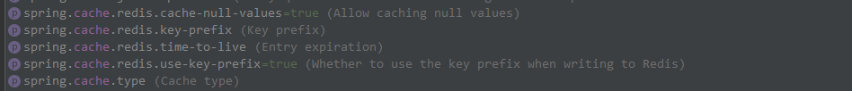

# redis 模块

目前，针对 redis 模块，我们统一封装了 `grus-boot-starter-redis`，规范大家对 redis 的使用。

> `grus-boot-starter-server-web`，`grus-boot-starter-server-service`等 starter 不再默认包含`grus-boot-starter-redis`，大家如果想使用 redis 相关功能，请导入如下依赖：

        <dependency>
            <artifactId>grus-boot-starter-redis</artifactId>
            <groupId>com.ciicgat.grus.boot</groupId>
        </dependency>

此 starter 自动包含 spring-boot-starter-data-redis 依赖，使用时需**联系运维配置**应用对应的 `redis-config.json`。

## 规范说明

> 鉴于过去 redis 的配置都由开发手动配置，不利于后期的维护和管理，我们不建议在项目的配置文件中，再由开发手动配置，统一交由运维配置。

我们移除了 `com.ciicgat.sdk.redis.RedisConfig` 类，避免大家项目中再有如下初始化 RedisExecutor 的方式，请使用 `grus-boot-starter-redis` 自动注入的 `redisExecutor` 替代。

```
    @Bean
    public RedisExecutor redisExecutor(){
        ConfigCollection configCollection = RemoteConfigCollectionFactoryBuilder.getInstance().getConfigCollection("xxx");
        RedisConfig redisConfig = configCollection.getBean("redis.properties", RedisConfig.class);
        return redisConfig.newRedisExecutor();
    }
```

**一定要注意**：如果项目因 RedisConfig 缺失而报错，请及时按照下面的文档修改。

## redis 统一配置

类似于数据库的 `datasource.json`，我们 redis 也有统一的 `redis-config.json`。它的**[配置格式说明见此处](https://architect.guide.wuxingdev.cn/redis/redis-config.html)。**

> 支持**redis 单机**和**sentinel**模式的，屏蔽了底层细节。只需要运维配置相应的配置文件即可。

应用满足如下条件时：

- 引入了 `grus-boot-starter-redis` 的 GAV；
- gconf 配置中存在 `redis-config.json`；

那么会自动加载 `GrusRedisAutoConfiguration`。

```java
@Configuration(proxyBeanMethods = false)
@ConditionalOnClass({RedisOperations.class, RedisClient.class, RedisSetting.class})
@AutoConfigureBefore(RedisAutoConfiguration.class)
public class GrusRedisAutoConfiguration {

    private static final Logger LOGGER = LoggerFactory.getLogger(GrusRedisAutoConfiguration.class);

    public static final String DEFAULT_REDIS_CONFIG_KEY = "redis-config.json";

    @AppName
    private String appName;

    @Bean(name = "redisSetting")
    @ConditionalOnMissingBean(name = "redisSetting")
    public RedisSetting redisSetting() {
        return RemoteConfigCollectionFactoryBuilder.getInstance().getConfigCollection(appName).getBean(DEFAULT_REDIS_CONFIG_KEY, RedisSetting.class);
    }

    @Bean
    @ConditionalOnBean(RedisSetting.class)
    @ConditionalOnClass(Jedis.class)
    @ConditionalOnMissingBean(name = "redisExecutor")
    public RedisExecutor redisExecutor(@Qualifier("redisSetting") RedisSetting redisSetting) {
        return redisSetting.newRedisExecutor();
    }

    @Bean
    @ConditionalOnBean(RedisSetting.class)
    @ConditionalOnClass({RedisOperations.class, RedisConnectionFactory.class})
    @ConditionalOnMissingBean(name = "redisConnectionFactory")
    public RedisConnectionFactory redisConnectionFactory(@Qualifier("redisSetting") RedisSetting redisSetting) {
        return SpringRedisConfCreator.newRedisConnectionFactory(redisSetting);
    }

    /**
     * 初始化自定义 redisService 时需要
     *
     * @param redisConnectionFactory redisConnectionFactory
     * @return StringRedisTemplate
     */
    @Bean
    @ConditionalOnMissingBean
    @ConditionalOnBean(RedisConnectionFactory.class)
    public StringRedisTemplate stringRedisTemplate(RedisConnectionFactory redisConnectionFactory) {
        checkRedisConnection(redisConnectionFactory);
        StringRedisTemplate template = new StringRedisTemplate();
        template.setConnectionFactory(redisConnectionFactory);
        return template;
    }

    @Bean
    @ConditionalOnMissingBean
    @ConditionalOnBean(StringRedisTemplate.class)
    public RedisService redisService(StringRedisTemplate stringRedisTemplate) {
        return new RedisService(stringRedisTemplate);
    }

    /**
     * 项目启动前，校验下 redis 连接是否成功，失败则项目启动失败
     *
     * @param redisConnectionFactory redisConnectionFactory
     */
    private void checkRedisConnection(RedisConnectionFactory redisConnectionFactory) {
        RedisConnection redisConnection = null;
        try {
            redisConnection = redisConnectionFactory.getConnection();
            redisConnection.ping();
            LOGGER.info("GAT Redis connect is normal");
        } catch (RuntimeException e) {
            LOGGER.error("GAT Redis connect error, please check redis-config.json in gconf or call operations", e);
            throw e;
        } finally {
            if (redisConnection != null) {
                redisConnection.close();
            }
        }
    }

}
```

一切都帮你自动加载好了，然后可以在项目直接注入使用 redis 相关的类。

### 使用方式

使用框架时，redis 常用操作类已经注入，如:

- StringRedisTemplate、RedisTemplate 等等（spring-data-redis 中的类，使用 lettuce）；
- RedisExecutor（原先我们常用的方式，使用 jedis）；
- RedisService（简单的封装，使用 lettuce）。

**Demo：**

```java
@Slf4j
@RestController
@RequestMapping
public class TestController {

    @Resource
    private RedisExecutor redisExecutor;

    @Resource
    private RedisService redisService;

    @Resource
    private StringRedisTemplate stringRedisTemplate;

    @GetMapping("/foo")
    public String foo() {
        String test = redisExecutor.execute(jedis -> jedis.get("test-1"));
        return test;
    }

}
```

### 特别说明

- 引入了 `grus-boot-starter-redis`，如果不配置 `redis-config.json`，项目启动会报错；

- 项目启动时会简单校验下 redis 的可用性，如果 redis 异常，项目启动会报错，请及时处理；

- 因为我们使用了自己初始化的 `RedisConnectionFactory`，所以 spring 默认的配置（如下）一般不会生效。

  ```properties
  spring.redis.host=redis.servers.dev.ofc
  spring.redis.port=6379
  spring.redis.database=15
  spring.redis.lettuce.pool.max-active=30
  ```

### 多个 redis

某些项目因为历史原因，链接了多个 redis。框架也支持使用，步骤如下：

1. 联系运维配置多个 redis-config.json 文件，一般主要使用的是 redis-config.json，另外的叫 redis-config-xxx.json；

2. 链接主 redis 的使用方式不变，redisExecutor、stringRedisTemplate 之类的照常使用；

3. 链接第二个 redis 的方式，事例如下（推荐第二个 redis 只用 redisExecutor 使用，不要使用 stringRedisTemplate，理由见下文）：

   ```java
   @Configuration
   public class RedisConfigure {

     	/**
     	 * 名字一定不能叫 redisSetting，与默认的区分
     	 */
       @Bean
       public RedisSetting phpRedisSetting() {
           return RemoteConfigCollectionFactoryBuilder.getInstance().getConfigCollection("payment").getBean("redis-config-php.json", RedisSetting.class);
       }

     	/**
     	 * 名字一定不能叫 redisExecutor，与默认的区分
     	 */
       @Bean
       public RedisExecutor phpRedisExecutor(RedisSetting phpRedisSetting) {
           return phpRedisSetting.newRedisExecutor();
       }
   }
   ```

4. 使用方式（一定要注明 `bean name`）

   ```java
   @Slf4j
   @RestController
   @RequestMapping
   public class TestController {
   
     	/**
     	 * 默认链接 redis-config.json 配置的 redis
     	 */
       @Resource
       private RedisExecutor redisExecutor;
   
     	/**
     	 * 链接 redis-config-php.json 配置的 redis <br/>
     	 * 如果使用 @Autowire，请配合 @Qualifier 一起使用，例如：<br/>
     	 * @Autowire
     	 * @Qualifier("phpRedisExecutor")
     	 * private RedisExecutor phpRedisExecutor;
     	 */
       @Resource
       private RedisExecutor phpRedisExecutor;
   
     	/**
     	 * 默认链接 redis-config.json 配置的 redis，不会链接 redis-config-php.json，请注意
     	 */
       @Resource
       private StringRedisTemplate stringRedisTemplate;
   
       /**
     	 * 默认链接 redis-config.json 配置的 redis，不会链接 redis-config-php.json，请注意
     	 */
       @Resource
       private RedisService RedisService;
   
       @GetMapping("/foo")
       public String foo() {
           String test = redisExecutor.execute(jedis -> jedis.get("test-1"));
           return test;
       }
   
   }
   ```

**备注：**

> redisExecutor 使用了自定义的 jedis 的连接池，底层的初始化并没有依赖 spring 的 redisConnectionFactory，只是最后将其交给了 spring 管理。所以按前文初始化即可使用。
>
> 如果 stringRedisTemplate 或 redisService，也想支持第二个 redis，例如：phpRedisService，需要同时初始化多个 redisConnectionFactory，初始化多个 stringRedisTemplate，配置不同的 connection，初始化多个 redisService，配置不同的 stringRedisTemplate。整体**比较麻烦**。
>
> 如果使用，请保证初始化正确，避免客户端连接错了 redis。

## RedisTemplate 与 Serializer

Springboot 与 redis 的交互是以二进制方式进行（byte[]）。为了支持 Java 中的数据类型，就要对操作的对象（key，value，hashKey，hashValue...）做序列化操作。

> redisTemplate 只为 key value hashKey hashValue 设置 serializer

### 序列化方法

Springboot 默认提供了几个序列化的方法：

- JdkSerializationRedisSerializer（默认）
- StringRedisSerializer
- Jackson2JsonRedisSerializer
- GenericJackson2JsonRedisSerializer
- ......

grus 针对一些大 key，value，额外提供了 `GzipRedisSerializer` 来使用，存储压缩过后的 key 和 value。

### 默认 Serializer

RedisTemplate 默认使用 JdkSerializationRedisSerializer 来进行，支持任意类型。但是，有一些问题：

- 这种默认的序列化方式会导致 redis 中保存的 key 和 value 可读性较差，出现一些不可读的 16 进制字符。例如：

  ```
  \xAC\xED\00\0x5t\x00
  ```

- 对象需要实现 java 的序列化接口，并且对象最好设置 `serialVersionUID` 为指定值（一般为 1L），不然对象新增或者删除字段后，序列化会出问题。

### 自定义序列化

如果希望采用别的序列化方式，例如：`Jackson2JsonRedisSerializer`，在 Configuration 代码初始化 bean：

```
    @Bean
    RedisTemplate redisTemplate(RedisConnectionFactory redisConnectionFactory) {
        RedisTemplate redisTemplate = new RedisTemplate();
        redisTemplate.setConnectionFactory(redisConnectionFactory);
        // 使用Jackson2JsonRedisSerialize 替换默认序列化(默认采用的是JDK序列化)
        Jackson2JsonRedisSerializer<Object> jackson2JsonRedisSerializer = new Jackson2JsonRedisSerializer<>(Object.class);
        ObjectMapper objectMapper = new ObjectMapper();
        objectMapper.setSerializationInclusion(JsonInclude.Include.NON_NULL);
        objectMapper.configure(DeserializationFeature.FAIL_ON_UNKNOWN_PROPERTIES, false);
        objectMapper.setVisibility(PropertyAccessor.ALL, JsonAutoDetect.Visibility.ANY);
        objectMapper.enableDefaultTyping(ObjectMapper.DefaultTyping.NON_FINAL);
        jackson2JsonRedisSerializer.setObjectMapper(objectMapper);

        redisTemplate.setKeySerializer(new StringRedisSerializer());
        redisTemplate.setHashKeySerializer(new StringRedisSerializer());
        redisTemplate.setValueSerializer(jackson2JsonRedisSerializer);
        redisTemplate.setHashValueSerializer(jackson2JsonRedisSerializer);
        return redisTemplate;
    }
```

## redis spring cache

**spring 默认实现**

使用 `grus-boot-starter-redis`。

只需要额外做以下配置即可：



cache 模块依赖`starter-data-redis`模块。实现大家可以看类`org.springframework.boot.autoconfigure.cache.RedisCacheConfiguration`和`org.springframework.data.redis.cache.RedisCacheManager`。

另外，**需要在启动类上加上`@EnableCaching`注解**

使用 spring 默认实现，**会存在一些问题**：

- 如果数据反序列化或者获取数据失败，会抛出异常返回，不存在 fallback。
- 没有接入我们的数据源

生产还是需要使用[Grus封装的cache框架](../cache/index.md)

## session

- 大家使用`spring-session-data-redis`

  ```
  <dependency>
      <groupId>org.springframework.session</groupId>
      <artifactId>spring-session-data-redis</artifactId>
  </dependency>

  ```

- 此模块同样依赖`starter-data-redis`模块

- 相关配置如下：

  ```
  server.servlet.session.cookie.name=gsId
  server.servlet.session.cookie.http-only=true
  server.servlet.session.cookie.secure=true
  server.servlet.session.cookie.path=/
  server.servlet.session.cookie.max-age=7200s
  
  spring.session.store-type=redis
  spring.session.timeout=1800s
  spring.session.redis.namespace=grus-demo:session  //这个需要修改成各自应用的，区分开来
  spring.session.redis.flush-mode=on_save
  ```

* 后续会对`spring-session-data-redis`的初始化进一步分装
