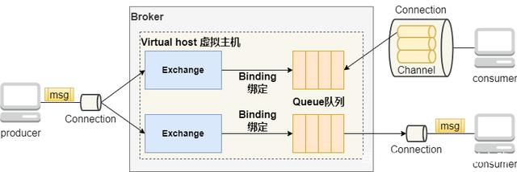

# Rabbitmq介绍

## 简述

本文主要讲解Grus中如何对rabbitmq的client进行封装、使用，如果对rabbitmq不了解的，可以先查看以下文章：

[RabbitMQ的工作模式及原理 (baidu.com)](https://baijiahao.baidu.com/s?id=1732891548341088166&wfr=spider&for=pc)

[RabbitMQ 工作原理和常用工作模式 --贺兰的博客_贺兰山的那个脉的博客-CSDN博客](https://blog.csdn.net/weixin_47301645/article/details/108911013)

下图比较经典的图：




说下架构层面的一些考虑：

1. 所有应用程序使用同一个rabbitmq服务器。
2. virtual host我们所有应用都固定使用根**/**。前两点的主要原因是：把**rabbitmq**定位于无障碍消息总线。
3. 考虑rabbitmq服务器连接上限，每个应用程序对服务端最多只有两个连接，producer和consumer各一个。大流量大并发场景，这可能会是一个性能限制，但目前足以覆盖关爱通所有场景。
4. 考虑到实际业务没那么复杂，所以我们做出限制：**一个jvm进程内，创建一个消费者或者一个生产者**。也就是Grus把channel限制到exchange上了。（实际上，channel在生产者情况可用于多个exchange、在消费者情况下可用于多个queue，不过这样子对于框架封装过于复杂）

## SDK

直接使用`grus-boot-starter-rabbitmq`。

```xml
<dependency>
    <groupId>com.ciicgat.grus.boot</groupId>
    <artifactId>grus-boot-starter-rabbitmq</artifactId>
</dependency>
```

新版本，必须使用starter模式。

## 初始化

启用初始化功能：

```properties
grus.rabbitmq.init.enable=true
```

交换机创建：

```properties
grus.rabbitmq.init.exchanges[0].name=grus-demo-test-exchange-direct
grus.rabbitmq.init.exchanges[0].type=direct
grus.rabbitmq.init.exchanges[1].name=grus-demo-test-exchange-fanout
grus.rabbitmq.init.exchanges[1].type=fanout
```

队列创建：

```properties
grus.rabbitmq.init.queues[0].name=grus-demo-test-queue
// 死信队列，声明死信交换机
grus.rabbitmq.init.queues[0].args.x-dead-letter-exchange=grus-demo-test.dead.exchange
grus.rabbitmq.init.queues[0].args.x-dead-letter-routing-key=
// 消息一个小时会过期
grus.rabbitmq.init.queues[0].args.x-message-ttl=3600000
// 优先级队列，最大优先级为10
grus.rabbitmq.init.queues[0].args.x-max-priority=10
```

队列和交换机绑定:

```properties
grus.rabbitmq.init.binds[0].queue=grus-demo-test-queue
grus.rabbitmq.init.binds[0].exchange=grus-demo-test-exchange
grus.rabbitmq.init.binds[0].routing_key=grus-demo-test //如果交换机是fanout模式，就是空了
```

注意点：

1. 对于已经创建的队列，无法更改其属性。可以通过控制台删除原队列，再带上属性创建一个新的。

## 生产者

启用生产者：

```properties
grus.rabbitmq.producer.enable=true
grus.rabbitmq.producer.parallel=4 //生产者的并发数
grus.rabbitmq.producer.createMessageId=true
grus.rabbitmq.producer.createTimestamp=true
```

当开启生产者后，框架会自动注入`RabbitMqProducer`单例，大家可以直接使用。

```java
 public class RabbitMQTest {
    @Autowired
    private RabbitMqProducer rabbitMqProducer;

    public void doSth(){
        var exchange = "grus-demo-test-exchange";
        var routingKey = "grus-demo-test";
        rabbitMqProducer.publish(exchange,routingKey,"i am a message");
    }
 }
```

提供了便捷的类`ExchangeProducer`，可以少传了exchange参数。

```java
@Configuration(proxyBeanMethods = false)
public class XXXConfiguration {
    @Bean
    public ExchangeProducer exchangeProducer(RabbitMqProducer rabbitMqProducer){
        return rabbitMqProducer.exchangeMsgDispatcher("grus-demo-test-exchange");
    }
}
public class RabbitMQTest {
    @Autowired
    private ExchangeProducer exchangeProducer;

    public void doSth(){
        var routingKey1 = "grus-demo-test-1";
        exchangeProducer.publish(routingKey1,"i am a message");
        var routingKey2 = "grus-demo-test-2";
        exchangeProducer.publish(routingKey2,"i am a message2");
    }
}
```


## 消费者

我们重点说下消费的一些问题。在架构上，对于消费者，主要有两点要求：

1. 保证消息不丢失
2. 保证消息可以重复消费

以上的两点，对于开发来说要求有点高，其需要正确处理各种场景、异常。比如以下常见的情况就会发生问题：
- 捕获了异常，但是对异常不做处理，最终无脑确认消息已消费。假如此时发生短暂的依赖服务异常，消息得不到重试的机会，进而导致数据丢失
- 捕获了异常，在异常发生时让消息重新入列。此种处理方式，虽然能保证消息不丢弃，但是对于那些无法处理异常的数据（比如json格式错误），会让导致其消息在程序和服务器之间来回踢皮球，而且此条消息永远结束不了。
- 不捕获异常，导致mq的消费线程直接crash，导致连接断开。

我们在新的框架下，努力解决上述问题。


启用消费者：

```properties
grus.rabbitmq.consumer.enable=true
grus.rabbitmq.consumer.parallel=4 //生产者的并发数
grus.rabbitmq.consumer.prefetch=3 //客户端预取的个数
grus.rabbitmq.consumer.maxRetry=5 //最大的重试次数
grus.rabbitmq.consumer.fallBack=true //遇到消息丢弃时，是否将消息发送到全局错误信息收集交换机
```

编辑队列的消息处理器：

```java
@MessageQueueListener("grus-demo-test-queue") //MessageQueueListener定义消费哪个队列
public class TestMsgProcessor implements MsgProcessor {
    @Override
    public State apply(Message message) {
        return State.OK;
    }
}

// 如果消息是json，可以这么写
@MessageQueueListener("grus-demo-test-queue-2") //MessageQueueListener定义消费哪个队列
public class TestMsgProcessor extends JSONObjectProcessor<TestData> {
    @Override
    public State handle(Message msg, TestData testData) {
        return State.OK;
    }
}


//如果消息处理器是
```


高级用法，如果程序想要多个队列共享一个消息处理器，程序根据队列名字自己做路由，可以这么写：

```java
@Configuration(proxyBeanMethods = false)
public class XXXConfiguration {
    @Autowired
    MsgProcessor msgProcessor(RabbitMqConsumer rabbitMqConsumer){
        Map<String, ? extends MsgProcessor> msgProcessorMap = Map.of("q1", new MsgProcessor() {
            @Override
            public State apply(Message message) {
                return State.OK;
            }
        },"q2", new JSONObjectProcessor<TestData>() {
            @Override
            public State handle(Message msg, TestData testData) {
                return State.OK;
            }
        });
        DispatcherMsgProcessor dispatcherMsgProcessor = new DispatcherMsgProcessor(msgProcessorMap);
        for (Map.Entry<String, ? extends MsgProcessor> entry : msgProcessorMap.entrySet()) {
            rabbitMqConsumer.consume(entry.getKey(),entry.getValue());
        }
        return dispatcherMsgProcessor;
    }
}
```


关于消费者返回状态说明：

1. 返回OK时，消息立即被确认消费，从queue中删除。
2. 返回Retry时，消息会重试（重新入列），最大重试次数看配置。超过最大重试次数后，默认往全局错误信息收集交换机发送该消息（此行为是框架做的）
3. 返回Abort时，消息会立即丢弃（拒绝，不入列），默认也会往全局错误信息收集交换机发送该消息。如果队列上设置了死信交换机，rabbitmq还会往死信交换机发。

tips：

1. 大家不用当心丢消息或者消息无法处理。在不确定时，可以返回Retry。
